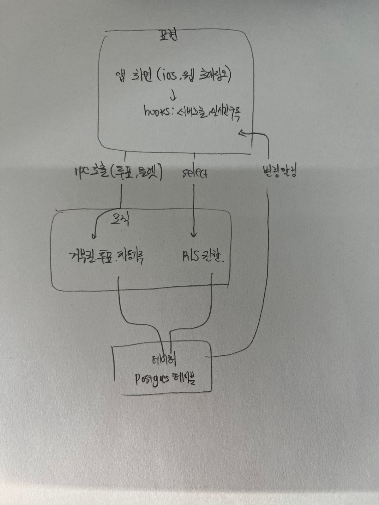
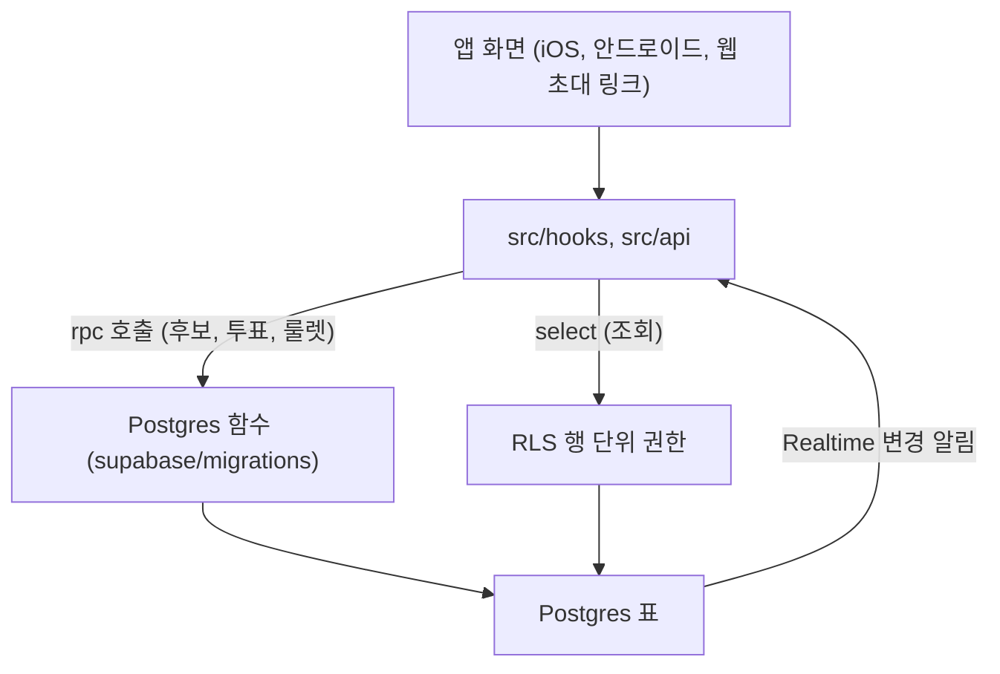

# 밥BTI (밥비티아이)

> 여럿이 밥 메뉴를 정할 때, 못 먹는 사람은 매번 말하지 않아도 걸리는 메뉴에 알림이 붙고, 결정은 투표와 룰렛이 대신 지고, 정한 메뉴는 학교 앞 가게와 쿠폰으로 이어지는 앱 (명세 0절, 2026-11-25 기준)

**배포 URL / Live URL:** https://babti.expo.app

- 초대 링크나 QR을 받은 사람은 설치와 가입 없이 웹에서 이름만 적고 들어온다
- 아이폰은 TestFlight, 안드로이드는 설치 파일로 나눠 준다. 앱스토어 정식 출시와 TestFlight 공개 링크는 준비를 마쳤고 제출은 팀장이 정한다(명세 13-1). main에 합치면 웹과 설치한 앱이 같이 바뀐다(expo-updates)

## 기능 / Features
화면 흐름 순서다. 명세 절과 완료 조건 번호는 명세 맨 앞 "한눈에"([`docs/spec.md`](docs/spec.md)), 처음 계획에서 바뀐 것은 같은 문서의 "처음 명세와 달라진 점"에 있다.

1. 모임과 QR 초대: 링크나 QR을 받은 사람은 설치와 가입 없이 웹에서 이름만 적고 들어온다. 아이디를 붙이면 다른 기기에서 이어 쓴다
2. 못 먹는 것과 식단: 재료 9개, 식단 5개(할랄, 힌두교, 채식, 페스코, 비건). 한 번 적으면 모든 모임에 쓰인다. 할랄은 인증이 아니라 재료(돼지고기) 기준이다
3. 후보와 직접 적기: 목록에 없는 메뉴도 적어 올린다. 빈 판은 모두 먹을 수 있는 메뉴 3개를 취향 순으로 채운다
4. AI 재료 추정과 두 단계 경고: 직접 적은 메뉴는 Gemini가 재료를 추정한다. 확실한 재료는 "못 먹는 사람이 있어요", AI만 추정한 재료는 "들어갈 수 있어요"로 옅게 알린다. 후보를 빼거나 투표를 막지 않는다
5. 익명 투표와 표 수 룰렛: 인당 1~3표, 정한 인원이 다 골라야 돌리고, 서버가 표 수에 비례해 뽑는다
6. 결과 카드: 메뉴 그림, 기념 딱지, 그림 공유, 음식 도감과 모임 타임라인
7. 학교 앞 가게와 쿠폰: 결과 화면과 가게 탭에 학교 앞 식당과 카페(공공데이터, 오픈스트리트맵). 혜택이 있는 제휴만 "광고", 쿠폰은 가게 직원이 확인한다
8. 현황판: 운영자는 쿠폰을 누가 받고 썼는지, 사장님은 이름 없는 숫자만 본다
9. 프로필과 맞춤: 네 글자 음식 타입, 레벨 막대, 메뉴 그림 아바타, 선택 항목인 단과대와 취향
10. 출시 필수와 보안: 계정 삭제, 금칙어와 신고와 차단, 모임 나가기, 판 접기, 처리방침과 약관, 남용 상한([`docs/security.md`](docs/security.md))
- 팀: "세션 제한의 90%를 사용했습니다." (AI+X 공학융합프로젝트, 2026-2학기)

## 1. 문제 정의 / Problem Definition
- 사용자 / Users: 친구, 동기, 동료와 같이 밥을 먹는 대학생과 직장인. 그중 알레르기, 할랄, 채식, 비선호처럼 못 먹는 것이 있는 사람
- 상황 / Situation: 여럿이 메뉴를 정할 때 "아무거나"가 오가고, 한 사람이 정하거나 단톡방 투표를 띄운다
- 페인포인트 / Pain point (사전 설문 78명, [`docs/survey-result.md`](docs/survey-result.md)):
  - 76.9%가 "아무거나"라는 답 때문에 메뉴 결정에 고민한 적이 있다. 46.2%가 메뉴를 정하는 데 5분 이상 쓴다
  - 55.1%가 못 먹거나 피하는 음식이 있다(알레르기 15.4%). 41.0%가 메뉴가 마음에 안 들어도 눈치 보여 그냥 먹은 적이 있다
  - 기존 투표, 룰렛을 써 본 61명 중 77.0%가 불편했다. 가장 많은 답은 "투표 안 한 사람을 마냥 기다림"(54.1%)
- 성공 기준 / Success criteria (명세 1절 1단계 완료 기준):
  - 서로 다른 기기 3대로 모임 만들기부터 결과와 식사 기록까지 한 판을 끝낸다
  - 못 먹는 것이 등록된 사람이 참여하면 걸리는 후보에 알림이 붙고, 누가 원인인지는 어디에도 나오지 않는다
  - 다른 사람의 표를 API로 직접 조회해도 0행이 나온다. 룰렛 결과는 서버가 정하고 모든 기기에 같다
  - 초대 링크를 받은 사람은 설치와 가입 없이 투표까지 간다

## 2. 사용자 확인 / User Validation
인터뷰 3명 요지 / Summary of three interviews (원문: [`docs/interviews.md`](docs/interviews.md), 이슈 #44):
1. 채식을 등록하니 고기가 든 후보가 다 지워져서 왜 빠지는지 몰랐다. 그래서 후보를 지우지 않고 "못 먹는 사람이 있어요"로 알리게 바꿨다 (PR #59)
2. 친구가 고르는 중에 먼저 돌려버렸다, 아무거나 먹어도 되는 사람이 누를 칸이 있으면 좋겠다. 그래서 정한 인원이 다 골라야 돌리기가 켜지고 "아무거나 괜찮아요"를 넣었다 (PR #59)
3. 검색칸에 음식 이름만 쓰고 고르지 않았다. 그래서 목록에 없는 메뉴도 적어 올리고, 엔터로도 올라가게 했다 (0008, PR #59)

세 사람 모두 "딱히 먹고 싶은 게 없을 때 고르기 어렵다"고 했다. 설문 78명 중 76.9%도 "아무거나" 때문에 고민한 적이 있다 ([`docs/survey-result.md`](docs/survey-result.md)).

## 3. 실행 방법 / How to Run
Node 버전은 `.nvmrc`를 따른다 (`nvm use`).
수업 제출용 오프라인 가게 전처리와 재료 평가 실행법은 [파이썬 안내](python/README.md)에 있다.
키는 `.env`에만 두고 커밋하지 않는다. 13주차 보안 점검(권한, 남용 막기, 비밀 키, AI 함수, 개인정보)과 남은 위험은 [`docs/security.md`](docs/security.md)에 있다.

```bash
npm install
cp .env.example .env
npx expo start --web
```

`.env`에 Supabase 주소와 공개 키를 채워야 로그인된다. 비어 있으면 "연결할 수 없어요" 화면이 뜬다.
필요한 환경변수 / Required environment variables: `.env.example` 참고

폴더 / Folders:

| 폴더 | 두는 것 |
|---|---|
| `src/app/` | 화면. 파일 이름이 주소가 된다 (expo-router). `supabase`를 import하지 않는다 |
| `src/components/` | 화면 조각. `supabase`를 import하지 않는다 |
| `src/hooks/` | 화면이 부르는 데이터 훅 (TanStack Query) |
| `src/api/` | Supabase 호출. 클라이언트는 `src/api/supabase.ts` 하나 |
| `src/constants/` | 규칙에 쓰는 숫자 (`index.ts` 하나) |
| `tailwind.config.js` | 색 토큰. 화면에는 색 이름만 쓴다 |

화면 폴더에서 `supabase`나 `src/api`를 import하면 린트가 실패한다 (`eslint.config.js`).

검사 / Checks: `npm run typecheck`, `npm run lint`, `npm test`, `npm run build:web` (PR마다 GitHub Actions가 같은 순서로 돈다)

서버 규칙 테스트 / DB tests: 로컬 Supabase(`npx supabase start`)를 띄운 뒤 `npm run test:db` (pgTAP, `supabase/tests/`). PR마다 GitHub Actions의 `db` 검사로도 돈다

## 4. 아키텍처 / Architecture




- 표현 계층 / Presentation: `src/app/`(화면, 파일 이름이 주소), `src/components/`(룰렛, 카드 등). 화면은 결과를 스스로 계산하지 않고 서버가 준 대로 그린다. 화면 파일은 `supabase`를 import하지 않는다(린트가 막는다)
- 로직 계층 / Logic: `src/hooks/`(TanStack Query, 실시간 구독)와 `src/api/`(Supabase 호출). 규칙은 서버의 Postgres 함수(RPC)가 실행한다: 못 먹는 것 판정(확실과 AI 추정 두 단계), 판마다 정한 표 수 상한(1~3), 정한 인원이 다 골라야 돌리기, 표 수 비례 룰렛 추첨, 식사 기록(`supabase/migrations/0003_rpc.sql`, 0009~0014)
- 데이터 계층 / Data: Supabase Postgres 표(모임, 소속, 판, 후보, 표, 식사, 못 먹는 것, 프로필, 가게, 쿠폰)와 RLS. 다른 사람의 표는 권한으로 막혀 API로도 0행. 기본 음식 40개와 재료 태그는 `supabase/seed/`
- 배포: 웹은 main에 합치면 GitHub Actions가 EAS Hosting에 올린다. 같은 단계에서 `eas update`로 설치한 앱에도 보낸다. PR마다 웹 미리보기 주소가 댓글로 달린다

규칙을 화면이 아니라 서버에 둔 이유: 룰렛 결과를 휴대폰이 정하면 방장이 조작할 수 있다. 투표 익명도 화면에서 이름을 숨기는 것만으로는 부족하고, 서버가 남의 표를 내주지 않아야 지켜진다(7주차 활동지)

## 5. 기술 스택과 선택 이유 / Tech Stack and Rationale

| 무엇 | 쓰는 것 | 고른 이유 |
|---|---|---|
| 앱 | Expo SDK 57 (React Native), TypeScript | 코드 하나로 아이폰, 안드로이드 앱과 웹을 같이 만든다. 링크를 받은 사람은 웹으로 바로 들어와야 한다 |
| 화면 이동 | expo-router | 파일 이름이 주소가 된다. 초대 링크 `/g/초대코드`를 바로 처리한다 |
| 화면 꾸미기 | NativeWind (Tailwind) | 디자인 담당이 익히기 쉽다. 색은 토큰 이름으로만 쓰고 테스트가 지킨다 |
| 서버, DB | Supabase (Postgres) | 서버를 직접 운영하지 않는다. 무료 요금제로 학기 내내 쓴다 |
| 실시간 | Supabase Realtime | 같은 자리에서 동시에 쓰는 앱이라 즉시 반영이 필요하다 |
| 로그인 | Supabase 익명 로그인, 아이디와 비밀번호 이어 쓰기 | 링크 받은 사람이 가입부터 하면 이탈한다. 기기를 바꿀 때만 아이디를 붙인다 |
| 데이터 불러오기 | TanStack Query | 서버 데이터를 저장해 두고 필요할 때 다시 불러온다 |
| 원판, 아이콘 | react-native-svg | 표 수에 따라 조각 크기가 바뀌는 원판 |
| 진동 | expo-haptics | 룰렛이 멈출 때, 네 글자가 나올 때 |
| 초대 QR | qrcode-generator | 앱 안에서 QR을 만든다. 외부 QR 서비스에 주소를 보내지 않는다 |
| 배포 | EAS Build, Submit, Update, Hosting | 웹 배포, TestFlight, 안드로이드 설치 파일, 심사 없는 수정본 반영 |
| 테스트, 검사 | Jest, pgTAP, ESLint, tsc | 서버 규칙(표 상한, 룰렛 대상, 익명)을 테스트로 고정한다 |
| 자동화 | GitHub Actions | PR마다 검사와 웹 미리보기, main 배포, Supabase 무료 요금제가 멈추지 않게 매일 한 번 요청 |

고르지 않은 것: Next.js 웹앱만 만들기(웹만으로는 진동과 앱 아이콘 경험이 없다), Flutter + Firebase(표 구조가 아니라 "누구와 몇 번 먹었는지" 같은 집계가 어렵다). 자세한 것은 명세 2절과 7주차 활동지.

## 6. 팀 구성 / Team
| 이름 Name | GitHub | 담당 영역 Area | 주요 이슈 Issues |
|---|---|---|---|
| 황병주 | eoieiie | 팀장. 명세, 세션과 투표, 룰렛과 식사 기록, 공통 화면 부품, PR 미리보기, 2단계 화면(온보딩, 내 프로필, 모임 카드, 결과 카드), 앱 배포 | #9 #10 #11 #12 #18 #40~#43 #50, PR #58 #59 #61 |
| 이혁준 | Aninnom | 뼈대와 익명 로그인, 데이터베이스와 서버 규칙, 2단계 서버 함수, 서버 반영 | #5 #7 #38 |
| 이학준 | Ruty041 | 초대 링크 참여, 못 먹는 것 등록과 정리(달걀 태그, 음식 태그) | #14 #39 |
| 이재곤 | GONI1130 | 홈과 모임 화면, 사전 설문, 로고와 마스코트, 앱 아이콘, 주황 테마 | #13, PR #52 #60 #62 #73 |

- 2단계 화면 #40(원래 Ruty041), #41 #42(원래 GONI1130)는 일정 때문에 11/12에 eoieiie가 만들고 원래 담당이 리뷰했다(`docs/decisions.md`)
- 사용자 인터뷰는 Aninnom, Ruty041, GONI1130이 각 1명씩 했다(#44)

## 7. 라이선스 / License
MIT ([`LICENSE`](LICENSE)) — 선택 이유 / Why: 기록 없음 (팀 확인 필요)

- 글꼴 Pretendard (orioncactus, SIL Open Font License 1.1, [`assets/fonts/Pretendard-OFL.txt`](assets/fonts/Pretendard-OFL.txt))
