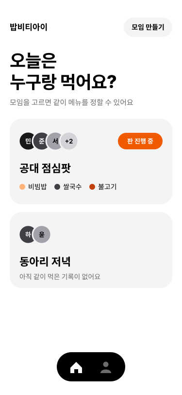
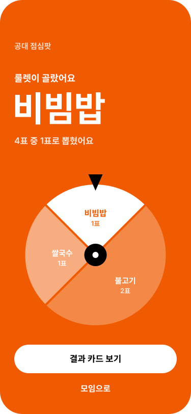
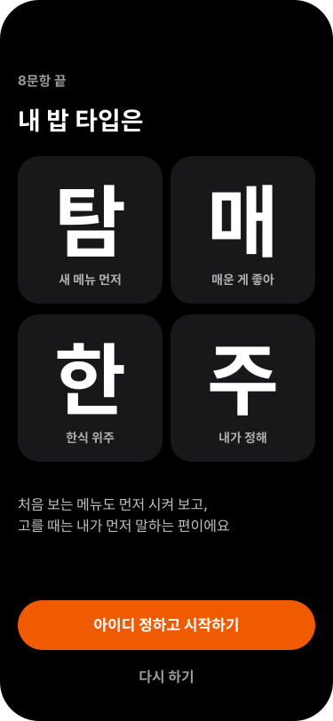
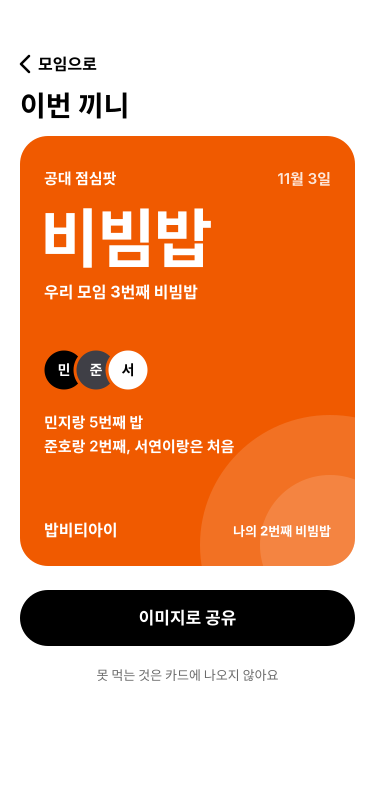

# 디자인 방향

2026-11-03 정함 (이슈 #45). 명세 7절의 디자인 규칙(주황 하나와 검정, 흰색, 회색, 공통 부품, 이모지 금지)은 그대로 두고, 그 위에 "어디를 얼마나 크게 보이게 하나"를 더한다. 1단계 화면 다듬기와 2단계 화면(I, J, K, L)은 이 파일을 따른다.

## 한 줄

평소 화면은 조용하게 두고, 결정이 나는 세 순간만 화면 전체를 쓴다.

중간 데모(11/11)와 데모데이(12/2)에서 다른 팀 학생들이 화면을 보고 평가한다. 화면 곳곳을 꾸미는 것보다 룰렛이 멈추는 순간, 내 네 글자가 나오는 순간, 공유할 카드가 크게 남는 쪽이 기억에 남는다. 색을 늘리지 않고 크기, 면, 움직임으로 화려하게 한다.

## 시안

<table>
<tr>
<td></td>
<td></td>
<td></td>
<td></td>
</tr>
<tr>
<td>평소 화면: 홈</td>
<td>순간 1: 룰렛이 멈출 때</td>
<td>순간 2: 네 글자가 나올 때</td>
<td>순간 3: 결과 카드</td>
</tr>
</table>

시안의 이름과 숫자는 가짜 데이터다. 실제 문구와 숫자는 명세 4절과 5절을 따른다.

## 1. 평소 화면

- 바탕 흰색(`bg-background`), 글자 검정(`text-text`), 카드 회색(`bg-surface`). 지금 홈 화면이 기준이다
- 글자 크기는 Tailwind 기본 단계만 쓴다

| 쓰는 곳 | 크기 | 굵기 |
|---|---|---|
| 화면 제목 ("오늘은 누구랑 먹어요?") | `text-4xl` | `font-extrabold tracking-tight` |
| 카드 제목 (모임 이름) | `text-2xl` | `font-extrabold` |
| 본문 | `text-base` | 기본 |
| 설명 | `text-sm` | 기본, `text-muted` |
| 세 순간의 큰 글자 | `text-6xl` ~ `text-8xl` | `font-extrabold` |

- 모서리: 카드는 `rounded-3xl`, 버튼과 알약은 `rounded-full`, 사람과 음식은 동그라미
- 사람은 이름 첫 글자를 넣은 회색 동그라미를 겹쳐 보인다. 색은 `food-8`, `food-2`, `food-4`, `food-6` 순서로 돌려 쓴다. 넷이 넘으면 네 번째 자리에 "+N"
- 주황은 카드마다 하나만 쓴다. 홈의 모임 카드라면 "판 진행 중" 알약이다. 사람 동그라미에는 쓰지 않는다
- 하단 탭(2단계)은 주황 알약에 흰 아이콘. 지금 화면만 흰 동그라미 안 검정 아이콘 (2026-11-16 재곤 제안, 병주 결정)
- 움직임은 누를 때 흐려지는 것(`active:opacity-80`, 지금 부품 그대로)뿐이다

## 2. 세 순간

### 순간 1. 룰렛이 멈출 때 (세션 결과, 4-12)

- 원판이 멈추면 바탕 전체가 주황(`bg-primary`)이 된다. 주황은 "고른 상태"라 명세 7절과 맞다
- 위에서부터 모임 이름(작게), "룰렛이 골랐어요", 음식 이름(`text-7xl`, 흰색), "N표 중 M표로 뽑혔어요"
- 원판은 그대로 남긴다. 뽑힌 조각만 흰색이고 나머지는 흰색을 옅게(조각마다 28%, 50%) 칠한다. 조각 안에 음식 이름과 표 수를 적는다. 표가 많을수록 조각이 커서, 표 수에 비례해 뽑는다는 동작 원리가 화면만 봐도 보인다
- 버튼: "결과 카드 보기"는 흰 바탕에 검정 글자(주황 바탕 위라서 주황 버튼을 쓰지 않는다), "모임으로"는 글자만
- 움직임: 원판이 멈추고 0.3초 뒤, 원판 가운데에서 바깥으로 0.45초 동안 주황이 번진다. 이어서 음식 이름이 0.9배에서 1배로 커지며 나타난다(0.2초). 진동은 지금처럼 멈출 때 한 번
- 담당: eoieiie (1단계 다듬기, PR #48)

### 순간 2. 네 글자가 나올 때 (온보딩 끝, 4-14)

- 바탕 전체가 검정이다. 2×2 칸에 네 글자를 하나씩 `text-8xl` 흰색으로 넣고, 칸 바탕은 `bg-food-8`이다. 글자 아래에 그 축의 뜻을 적는다 ("새 메뉴 먼저")
- 그 아래 두 줄 설명, 맨 아래 주황 버튼 "아이디 정하고 시작하기"와 글자 버튼 "다시 하기"
- 움직임: 칸이 0.12초 간격으로 하나씩, 아래에서 12만큼 올라오며 나타난다. 네 번째 칸이 나올 때 진동 한 번(`Haptics.notificationAsync(Success)`)
- 검정 바탕은 토큰 `ink`(#000000)와 그 위 글자 `on-ink`(#FFFFFF)로 쓴다 (PR #48에서 더함)
- 담당: Ruty041 (#40)

### 순간 3. 카드 (결과 카드 4-17, 내 프로필 4-15, 모임 카드 4-16)

- 공유되는 카드는 포스터처럼 만든다. 가로세로 4:5, `rounded-3xl`, 안쪽 여백 24
- 결과 카드: 주황 바탕. 위에 모임 이름과 날짜, 가운데 음식 이름(`text-6xl`)과 "우리 모임 N번째 OO", 같이 먹은 사람 동그라미와 "OO랑 N번째 밥", 아래에 "밥비티아이"와 "나의 N번째 OO". 오른쪽 아래에 옅은 흰 동그라미 두 개를 겹친다(음식 동그라미를 크게 키운 무늬)
- 내 프로필 카드: 검정 바탕에 순간 2의 네 글자 칸을 작게 넣는다. 아래에 아이디와 레벨
- 모임 카드(모임 화면 안에 있고 공유하지 않는다): 회색 카드. 태그별 인원은 검정 막대, 네 축은 가운데 0에서 양쪽으로 뻗는 막대. 3명 미만이면 명세 4-16의 문구
- 공유 버튼은 검정(`bg-ink`). 카드가 이미 주황이라 버튼까지 주황이면 강조가 둘이 된다
- 공유 카드 아래 한 줄: "못 먹는 것은 카드에 나오지 않아요" (명세 4-15)
- 움직임: 카드가 처음 보일 때만 0.96배에서 1배로 커진다(0.25초)
- 담당: eoieiie (#43 결과 카드), GONI1130 (#41 프로필 카드, #42 모임 카드)

## 3. 지키는 것

- 움직임은 원판과 같은 React Native `Animated`로 만든다. reanimated는 아직 켜지 않았고 새 라이브러리도 넣지 않는다. `Animated.View`는 className을 받지 않으니 style로 준다
- 기기에서 "동작 줄이기"를 켠 사람에게는 움직임 없이 마지막 모습만 보인다 (`src/hooks/use-reduce-motion.ts`의 `useReduceMotion`, PR #48)
- 움직임은 세 순간에만 넣고, 하나가 0.5초를 넘지 않는다. 시연 중에 기다리는 시간이 생기면 안 된다
- 진동은 `expo-haptics`로 순간마다 한 번
- 순간 화면도 색은 토큰 이름만 쓴다. 이모지와 테두리만 있는 박스는 여전히 쓰지 않는다 (`src/components/design-rules.test.js`)
- 시연은 웹(https://babti.expo.app)으로 한다. 폰 브라우저와 노트북 브라우저 둘 다에서 본다

## 4. 덜어 내기

2026-11-09 더함 (PR #51에서 화면에 적용). 평소 화면을 조용하게 두려면 더하기보다 빼야 한다. 다른 팀이 처음 보는 화면이라 읽지 않고도 알 수 있어야 한다. 2단계 화면(I, J, K, L)도 이 규칙을 따른다.

1. 설명 줄을 뺀다. 제목과 버튼이 할 일을 말하면 그 아래 설명은 없앤다. 남기는 것은 명세 4절 문구와 처음 온 사람이 꼭 알아야 하는 한 줄뿐이다 (초대 화면 "가입 없이 이름만 적으면 들어가요", 투표 "누가 뭘 골랐는지는 아무도 몰라요")
2. 같은 역할은 같은 크기. 고르기 칸(음식, 태그)은 글 길이에 맞추지 않고 같은 폭의 칸으로 나눈다. 한 줄에 놓인 버튼도 같은 폭이다
3. 글보다 아이콘. 뒤로, 모임 만들기, 고른 표시, 빼기는 `src/components/icon.tsx`의 아이콘을 쓴다. 읽어 주는 이름(`accessibilityLabel`)은 글 그대로 둔다
4. 상태는 말 대신 면과 선으로. 고른 카드는 주황 면에 체크, 쓰는 중인 입력칸은 검정 선, 투표한 사람은 검정 동그라미. "골랐어요" 같은 글을 붙이지 않는다
5. 얇은 것을 쓰지 않는다. 아이콘 선 2.8, 진행 막대 높이 12, 단계 표시는 "2 / 3 투표" 한 줄과 높이 12 막대 세 칸 (2026-11-16 병주 1안. 버튼 모양 칸은 누르는 것처럼 보여서 바꿈)
6. 꺼진 버튼은 회색 덩어리(`surface-strong`, 글자 `muted`). 흐린 주황은 힘없어 보인다
7. 같은 버튼을 한 화면에 두 번 두지 않는다. 모임이 없는 홈에는 "첫 모임 만들기" 하나만 있다
8. 글자 수는 상한의 80%를 넘을 때만 보인다
9. 노트북에서는 가운데 폭 480 안에만 그리고 바깥은 회색이다. 시연 때 노트북 화면을 공유해도 폰 화면처럼 보인다
10. 웹에서 한글은 단어 단위로 줄을 바꾼다 (`word-break: keep-all`). "이/름"처럼 낱자로 끊기지 않는다

## 5. 누가 언제

| 무엇 | 담당 | 언제 |
|---|---|---|
| 1단계 다듬기: `Card` 모서리, `ink`·`on-ink` 토큰, 홈 모임 카드(사람 동그라미, 최근 식사, 판 진행 중), 순간 1 | eoieiie | PR #48, 인터뷰 전 |
| 순간 2 | Ruty041 | #40 (11/18) |
| 하단 탭, 내 프로필 카드, 모임 카드 | GONI1130 | #41, #42 (11/18) |
| 결과 카드 | eoieiie | #43 (11/18) |
| 발표자료와 시연 영상도 같은 색과 글자를 쓴다 | 13주차에 정함 | 11/25 ~ 12/1 |

## 화면 숫자 기준 (2026-11-19, 병주 "ui ux 수정")

폰 폭 390에서 읽기 좋은 굵기, 단추 모양, 모서리를 숫자로 정했다. 색은 그대로 주황 하나.

| 항목 | 기준 | 밥비티아이 전 | 밥비티아이 뒤 |
|---|---|---|---|
| 굵기 | 본문 400·500, 제목 700, 800은 거의 없음 | 800(extrabold) 53곳 | 800은 5xl 이상 큰 숫자·이름에만, 나머지 제목 700 |
| 큰 버튼 모양 | 높이 48, 모서리 16의 둥근 네모 | 알약(rounded-full) | 모서리 16(`rounded-2xl`). 높이 56은 그대로(주황 위 20 굵은 흰 글자 대비 때문) |
| 줄 안 작은 버튼 | 모서리 8~12 | 알약 | 모서리 12(`rounded-xl`) |
| 알약을 남기는 곳 | 이름표, 상태 딱지 | 거의 모든 누르는 것 | 이름표, 못 먹는 것 태그, 동그라미 아이콘 버튼, 아래 탭 |
| 카드 | 옅은 면, 모서리 24, 그림자 없음 | 같음 + 일부 그림자 | 그림자 뺌 |
| 그라데이션 | 없음 | 네 글자 결과, 프로필 카드 | 뺌. 주황 한 면 |
| 설명 줄 | 제목 아래 한 줄도 드묾 | 초대 카드 "가입 없이 이름만 적으면 들어가요" | 뺌 |

바뀐 규칙: 위 "큰 버튼은 알약" 규칙(1절)은 2026-11-19에 "큰 버튼은 모서리 16의 둥근 네모"로 바꿨다. 예전 줄은 기록으로 둔다.

### 앱(아이폰)에서만 생기는 것

- 입력칸이 있는 화면과 창(이름, 아이디, 초대 들어가기, 새 모임)은 `KeyboardSafe`로 감싼다. 키보드가 아래 버튼을 가리지 않는다
- 스크롤 화면은 `keyboardShouldPersistTaps="handled"`. 키보드가 열린 채로 "올리기" 같은 버튼이 한 번에 눌린다(전에는 첫 번째 누름이 키보드만 닫았다)
- 한글 큰 글자는 `leading-none`을 쓰지 않는다. 아이폰에서 글자 위가 잘린다

### 글꼴 (2026-11-19, 병주 "응 ㄱㄱ")

- 모든 글자는 Pretendard(OFL-1.1). 시스템 기본 글꼴은 "기본값 느낌"이 나서 바꿨다
- 화면에서는 `react-native`의 `Text`, `TextInput` 대신 `@/components/text`를 쓴다. 여기서 글꼴 이름 하나를 붙이고, 굵기는 `font-semibold`, `font-bold`로 고른다(2026-11-26부터 `font-extrabold`는 로고만)
- 앱에 넣은 굵기: 400(기본), 600, 700, 800. `font-black`(900)은 쓰지 않는다(로고는 800으로 바꿈). 다른 굵기를 쓰려면 `app.json` expo-font에 파일을 더하고 앱을 새로 빌드한다
- 웹은 Pretendard 웹 글꼴(dynamic subset)을 늦게 받아 붙인다. 받기 전에는 시스템 글꼴로 먼저 그린다(QR 합류가 글꼴 때문에 늦지 않게)
- 1.0.0 (6) 이하로 깐 앱은 글꼴 파일이 없어 시스템 글꼴로 보인다. 1.0.0 (7)부터 Pretendard

## 화면 규칙 (2026-11-25, 병주 "주황색이 너무 많다, 포인트컬러로", "박스칸들 너무 얇다")

간격, 모서리, 누르는 크기, 색을 숫자와 원칙으로 정했다. 같은 역할의 자리가 화면마다 같은 값이어야 처음 보는 사람도 묶음을 바로 읽는다.
이 절이 위의 1절, 2절, 4절, "화면 숫자 기준 (2026-11-19)"과 어긋나면 이 절이 이긴다. 예전 줄은 기록으로 둔다.

- 자동 검사: `src/components/design-rules.test.js`의 "간격은 눈금만", "주황 면은 파일 하나에 한 곳까지", "상자를 테두리로 그리지 않는다"

### 1. 빼기 원칙 (모든 화면에 먼저 적용)

1. 더하는 것보다 빼는 것. 요소, 문장, 설명은 줄일 수 있는 만큼 줄인다. 사용자가 고민하지 않아야 한다
2. 같은 역할은 같은 크기. 단추를 글 길이에 맞추지 않는다. 한 줄, 한 묶음의 단추와 고르기 칸은 같은 폭과 같은 높이(격자로 나눈다)
3. 글보다 아이콘. 뜻이 분명한 아이콘을 쓰고, 애매할 때만 짧은 이름을 붙인다
4. 강조는 말이 아니라 포인트 색과 선으로. 안내 문장을 붙이지 않는다. 예: "OO 님이 고치는 중" 대신 프로필 동그라미만

### 2. 눈금

- 간격은 4, 8, 12, 16, 24, 32만 쓴다. Tailwind로는 `1`, `2`, `3`, `4`, `6`, `8`. `0.5`(2)는 같은 종류 줄 사이에만 쓴다
- 가까우면 한 묶음으로 읽힌다. 묶음 사이 간격은 묶음 안 간격의 2배 이상이어야 한다
- 눈금 밖 숫자가 필요하면 묶음을 잘못 나눈 것이다. 꼭 필요한 눈금 밖 값은 이름과 이유를 달아 둔다. 지금은 하나뿐이다: 굴러가는 화면 끝을 비우는 자리(`pb-10` 이상, `pt-16`). 떠 있는 단추 줄이나 탭 막대 높이만큼 비우는 자리라 묶음 사이 간격이 아니다
- 묶음을 먼저 적고 간격을 준다. 선을 긋기 전에 간격으로 나눠 본다. 이유는 셋 중 하나여야 한다: 묶음(가까움과 떨어짐), 리듬(줄 높이와 단추 높이의 배수), 읽기(한 줄 글자 수, 손가락 크기). "예뻐서"는 이유가 아니다
- 같은 역할의 자리는 전부 같은 값으로 바꾼다. 한 화면만 고치지 않는다

### 3. 어디에 몇을 쓰나

| 관계 | 값 | 밥BTI 클래스 | 밥BTI 예 |
|---|---|---|---|
| 한 줄 안의 아이콘(그림)과 글 | 8 | `gap-2` (그림 칸은 `gap-3`) | 고르기 칸의 그림과 이름 |
| 제목과 바로 아래 설명 | 4 | `gap-1` | 후보 이름과 "못 먹는 사람이 있어요" |
| 같은 종류 줄 | 2~4 | `gap-0.5`, `gap-1` | |
| 같은 종류 카드 사이 | 8~12 | `gap-2`, `gap-3` | 후보 카드, 식사 기록 칸 |
| 역할이 다른 묶음 사이 | 16~24 | `gap-4`, `gap-6` | 판 화면의 찾기와 후보 |
| 화면의 큰 구역 사이 | 24~32 | `gap-6`, `gap-8` | 모임 화면의 구역들 |
| 카드 안 여백 | 12(작은 카드), 16(보통) | `p-3`, `p-4` | `Card`, 후보 카드 |
| 창(대화상자) 안 여백 | 24 | `p-6` | 새 모임, 같이 먹을 사람 |
| 휴대폰 화면 옆 여백 | 16 | `px-4` | 모든 화면 (전에는 `px-5`, 20) |

### 4. 창(대화상자)

| 자리 | 값 | 밥BTI |
|---|---|---|
| 창 안 여백 | 24 | `p-6` |
| 제목과 설명 | 8 | `gap-2` |
| 설명과 버튼 줄 | 24 | `gap-6` |
| 버튼 사이 | 8 | `gap-2` |
| 버튼 높이 | 48(창), 36(목록), 44(휴대폰) | 큰 단추 56 그대로(2026-11-19 결정: 주황 위 20 굵은 흰 글자 대비), 줄 안 단추 44~48 |
| 창 폭 | 440(묻는 창) | `max-w-[440px]` (전에는 384) |
| 창 모서리 | 24 | `rounded-3xl` |

### 5. 둥글기

| 무엇 | 값 | 밥BTI 클래스 |
|---|---|---|
| 창, 시트, 공유하는 포스터 카드 | 24 | `rounded-3xl` |
| 카드, 큰 단추 | 16 | `rounded-2xl` |
| 따로 놓인 작은 것(고르기 칸, 작은 단추) | 12 | `rounded-xl` |
| 카드 안 단추와 입력칸 | 8 | `rounded-lg` |
| 알약 | 이름표, 상태 딱지 | 이름표, 상태 알약, 못 먹는 것 태그, 동그라미 아이콘 단추, 아래 탭 |

- 안쪽 모서리 = 바깥 모서리 - 안쪽 여백. 나란히 보이는 두 둥글기는 중심이 같아야 맞아 보인다. 카드(16) 안 여백이 16이면 0이 되므로 최소값 8을 쓴다
- 사람과 음식은 동그라미

### 6. 누르는 크기

- 휴대폰에서 누르는 것은 높이 44 이상(`h-11`). 서로 8 이상 띄운다
- 모양을 작게 두고 싶으면 보이는 크기는 그대로 두고 누르는 영역만 44로 키운다

### 7. 면으로 나누기

- 상자를 테두리로 그리지 않는다. 옅은 면(`bg-surface`)과 여백으로 나눈다
- 선은 간격으로 안 나뉠 때만 한쪽에 긋는다(`border-b`)
- 허용하는 선은 셋이다: 겹친 동그라미 사이의 바탕색 고리, 쓰는 중인 입력칸의 검정 선, 잠깐 보였다 사라지는 주황 선(새 후보, 새 멤버, 판이 열림)
- 고른 항목의 바탕을 따로 칠하지 않는다. 고른 표시(채운 동그라미)가 이미 말해 준다

### 8. 색: 주황은 포인트로만

| 주황을 쓰는 곳 | 주황을 쓰지 않는 곳 (2026-11-25에 뺌) |
|---|---|
| 화면의 주 단추 하나 (`Button` primary) | 고른 투표 카드 전체 → 검정 체크 동그라미 |
| 홈 모임 카드의 "판 진행 중" 알약 | 초대 코드 카드 → 검정 카드 |
| 잠깐 보이는 선(새 후보, 새 멤버, 판이 열림) | 초대받은 모임 카드 → 옅은 면 |
| 룰렛 결과 순간과 결과 카드 (예외: 주황 한 면) | 네 글자 결과 화면 전체 → 검정 바탕에 흰 칸 |
| | 못 먹는 것에서 고른 태그 → 검정 |
| | 모임 멤버 동그라미 → 회색 네 단계 |
| | "우리 모임" 막대 → 검정 |
| | 직접 올리기 줄, 어필 저장, 결과 카드 공유 단추 → 검정 |

- 한 화면에 주황은 한 곳이다. 큰 면에는 쓰지 않는다
- 고른 상태는 검정(`bg-ink`, 글자 `text-on-ink`)으로 보인다. 주황을 주 단추 하나에 남기기 위해서다
- 파일 하나에 주황 면(`bg-primary`)이 둘 이상이면 검사가 실패한다

### 9. 얇은 칸 금지

- 목록 칸은 왼쪽에 그림을 둔다. 고르기 칸 40, 목록 줄 48, 카드 56 (`FoodThumb`의 `xs`, `sm`, `md`)
- 칸 높이는 72 이상, 안 여백 16. 그림 48에 여백 16이면 80이다
- 그림은 기본 음식 40개의 일러스트를 흰 원 안에 넣는다. 그림이 없는 직접 적은 메뉴는 흰 원 안에 그 음식의 색 동그라미를 넣는다
- 그림 주소는 한 번에 받아 10분 둔다(`useFoodImageMap`). 칸마다 따로 묻지 않는다
- 아바타는 목록 30(밥BTI는 4의 배수로 32), 카드 44

### 10. 재사용 부품 대응

| 부품 | 기준 | 밥BTI |
|---|---|---|
| 체크박스, 라디오 | 18, 고르면 검정 채움에 흰 체크 | 투표 카드의 고른 표시: 44 동그라미, 고르면 검정 채움에 흰 체크 |
| 고르기 | 한 판 안의 같은 폭 칸, 고른 칸 검정 | 못 먹는 것 태그(한 줄에 넷, 같은 폭), 고른 태그 검정 |
| 켜고 끄기 | 스위치 | "아무거나 괜찮아요" (고르면 검정) |
| 실행 단추 | 한 창에서 같은 폭 | 창의 두 단추는 반씩, 초대 카드의 두 단추는 반씩 |
| 휴대폰 아래 줄 | 주 단추 하나, 전체 폭, 양옆 16, 높이 54 | 주 단추 하나, 전체 폭, 양옆 16, 높이 56 |
| 설정 줄 | 이름 왼쪽, 조작 오른쪽 끝, 안 여백 12 | 프로필 탭의 설정 줄 |
| 빈 화면 | 왜 비었는지와 다음 할 일 단추 | 빈 홈: 마스코트, "아직 모임이 없어요", "첫 모임 만들기" |

### 11. 문구

- 해요체, 쉬운 말, 한 문장에 하나
- 직접 적은 메뉴의 재료는 AI가 이름으로 추정한 것이다. 재료를 다 띄우지 않고 "재료 확인 필요*" 한 줄만 보인다. 누르면 재료마다 이유 한 줄과 "* AI가 메뉴 이름으로 추정했어요. 가게마다 다를 수 있어요"가 펴진다(병주 2026-11-25). 투표 카드에서는 이 줄이 "고르기" 버튼 밖에 따로 있다(버튼 안에 버튼을 두지 않는다)
- 못 먹는 사람이 걸릴 때의 "OO 못 먹는 사람이 있어요"는 그대로다

### 12. 2026-11-25에 고친 곳

코드에서 센 값이다. 눈금 밖 간격은 17개 파일 41곳에서 0곳으로, 주황 면은 16곳에서 6곳(홈 알약, 주 단추, 네 글자 화면의 주 단추, 오류 화면의 다시 시도, 결과 순간, 결과 카드)으로 줄었다.

| 화면 | 어긴 규칙 | 고침 |
|---|---|---|
| 모든 화면 | 옆 여백 20, 카드 안 여백 20, 간격 20과 28과 40 (눈금 밖) | 옆 여백 16, 카드 안 여백 16, 간격 16과 24와 32 |
| 모든 카드 | 모서리 24 (창과 같은 값) | 16. 카드 안 입력칸과 단추는 8 |
| 홈 모임 카드 | 그림 없이 글만 | 가장 최근에 먹은 음식 그림 56, 이름, 최근 먹은 것 한 줄, 사람 동그라미와 인원수 |
| 모임: 멤버 동그라미 | 주황 세 색, 56 | 회색 네 단계, 44 |
| 모임: 초대 카드 | 주황 큰 면 | 검정 카드 |
| 모임: 최근에 먹은 것 | 큰 상자 안에 높이 44짜리 줄, 그림 40 | 한 끼가 한 칸(높이 80), 그림 48 |
| 모임: 우리 모임 | 주황 막대 | 검정 막대 |
| 판: 후보 카드 | 색 동그라미 40뿐, 높이 72 | 음식 그림 56, 높이 88 |
| 판: 음식 고르기 칸 | 색 동그라미 24, 높이 48 | 음식 그림 40, 높이 56 |
| 판: 직접 올리기 줄, 어필 저장 | 주황 (주 단추 "투표 시작"과 겹침) | 검정 |
| 판: 투표 카드 | 고르면 카드 전체가 주황, 고른 수만큼 주황 면 | 카드는 그대로, 검정 체크 동그라미 |
| 판: 직접 적은 메뉴 | "AI가 추정한 재료, 돼지고기, 해산물…"을 늘 다 보임 | "재료 확인 필요*" 한 줄, 누르면 펴짐 |
| 네 글자 결과 | 화면 전체 주황 | 검정 바탕, 흰 칸, 주황은 주 단추 하나 |
| 초대 들어오기 | 주황 카드와 주황 단추 | 옅은 면 카드, 주황은 "들어가기" 하나 |
| 못 먹는 것 | 고른 태그마다 주황, 저장 단추도 주황 | 고른 태그 검정, 주황은 저장 하나 |
| 결과 카드 화면 | 주황 카드 아래 주황 공유 단추 | 검정 공유 단추 |
| 창 | 폭 384 | 440 |

통일 점검: `src/app`과 `src/components`의 모든 화면 파일에 간격·주황 면·테두리 상자 검사를 적용한다. 지난 쿠폰은 왼쪽에 56 크기 가게 그림(사진 → 음식 그림 → 아이콘)을 두고, 높이 80 이상·안 여백 16인 면으로 구분한다. 운영자·사장님 현황판은 같은 폭의 수치 칸과 회색 면을 쓴다.

## 글자를 말줄임으로 자르지 않는다 (병주, 2026-11-25)

병주: "저렇게 잘리는 부분 없으면 좋겠음" (결과 화면의 "이삭토스트 안산한양..." 캡처).

- 이름, 혜택, 정보 줄 모두 `numberOfLines`, `ellipsizeMode`, `adjustsFontSizeToFit` 없이 줄바꿈한다. 고정 높이 칸은 최소 높이(`min-h-*`)와 위아래 여백으로 바꿔 두 줄이 되어도 넘치지 않게 한다. 자동 검사: `src/components/design-rules.test.js`
- 가게 이름은 목록, 결과 줄, 가게 상세 제목에서 지점 꼬리(안산한양대점, 한양대에리카점, (한양대점), 안산직영점, 사동본점 등)를 뗀 이름을 보인다(`shortShopName`). 보배반점의 "반점"처럼 이름 자체인 것은 그대로. 지도 링크와 찾기는 원래 이름
- "광고"와 "OO 제휴" 표시는 이름 옆에 두고, 이름이 길면 줄을 넘겨 다음 줄로 간다(flex-wrap)
- 학생회 혜택은 목록과 결과 줄에서 항목마다 한 줄(`benefitLines`, 괄호만 있는 안내 줄은 뺌), 가게 상세는 원문 전부
- 아래 버튼 띠와 탭 막대 바로 위에는 바탕색으로 옅어지는 짧은 띠(`FadeEdge`, 24~32)를 두고, 스크롤 끝에 마지막 줄이 완전히 올라올 여백을 둔다. 탭 막대 위 선은 이 띠로 바꿨다

## 홈 모임 카드 꾸밈 (2026-11-26, 병주 1안 "먹은 음식 줄")

병주(실제 폰 홈을 보고): "지금 색감이랑 배치는 이 화면에서 아주 좋거든? 대신 너무 저 카드 부분이 휑한 느낌이야." 시안 셋(먹은 음식 줄, 큰 그림 하나, 음식 무늬 배경) 중 1안을 골랐다. 모임 카드 오른쪽 아래, 사람 동그라미 줄과 같은 높이에 그 모임이 같이 먹은 음식을 작은 원으로 겹쳐 둔다(`src/components/plate-foods.tsx`). 원은 그림 32에 카드 바탕색 고리 2를 더한 36이고 옆 원과 10씩 겹친다. 최근 것이 오른쪽이고 최대 4개, 같은 음식은 한 번이다. 맨 오른쪽(가장 최근)을 뺀 원들 위에 카드 바탕색(`surface`)으로 옅어지는 띠를 덮어 왼쪽으로 갈수록 흐리게 한다(react-native-svg, 새 패키지 없음). 그림이 없는 직접 적은 메뉴는 흰 원 안 색 동그라미 그대로다. 기록이 없는 모임은 같은 자리에 점선 빈 접시 둘(`surface-strong` 선 2). 원 줄은 사람 줄(34)보다 2 커서 위아래로 1씩 넘겨 카드 높이를 바꾸지 않는다. 인원수("3명")는 사람 동그라미 바로 옆(8)으로 옮겨 사람과 한 묶음이 되게 했다. 글과 겹치지 않고 설명 문장은 없다. 꾸밈이라 화면 읽기 프로그램에는 숨긴다(카드 글이 이미 메뉴를 말한다). 자료는 서버 함수 `home_group_foods`(0053). 모임이 하나도 없는 빈 홈에는 "첫 모임 만들기" 아래 회색 작은 글자 단추 "어떻게 하나요"를 두고 `/about`으로 보낸다. 모임이 생기면 빈 홈과 함께 사라진다.

## 떠 있는 아래 탭과 박스, 글자 정돈 (2026-11-26, 병주)

병주: "네비게이션바 바꿔줘", "박스 크기같은 것도", "지금 디자인이나 색배합도 좋으니 알아서", "글자의 성격별 크기나, 비율, 정렬". 흰 바탕, 회색 카드, 주황 하나의 색 배합은 그대로 둔다. 이 절이 위 절과 어긋나면 이 절이 이긴다. 예전 줄은 기록으로 둔다.

### 아래 탭

- 화면 아래에 떠 있는 흰 알약. 양옆 16(`px-4`), 안전 영역 위로 8, 높이 64, 모서리 끝까지 둥글게
- 세 칸(홈, 가게, 내 프로필)은 같은 폭(`flex-1`). 아이콘만 두고 읽어 주는 이름은 그대로
- 지금 화면은 옅은 주황 원(44, `bg-primary-soft`) 안에 주황 아이콘, 나머지는 회색 아이콘. 지금 어디인지를 글 없이 색 하나로 보인다
- 목록은 알약 뒤로 지나간다. 막대가 화면 폭을 다 덮지 않아 화면이 위아래로 넓어 보인다. 목록 끝은 알약 높이만큼 비워(`TAB_BAR_SPACE` 130) 마지막 줄이 알약 위로 다 올라온다
- 흰 바탕 위의 흰 알약이라 묻히지 않게 그림자를 둔다(`FLOAT_SHADOW`, 불투명 12%, 퍼짐 16). 그림자는 이 알약에만 쓰고 카드에는 쓰지 않는다
- 엄지가 닿는 화면 아래쪽에 누르는 자리를 크게(칸 하나 폭 100 안팎, 높이 64) 둔다
- 전에는 화면 아래에 붙은 흰 막대에 지금 탭만 주황 아이콘이었다(4-26)

### 박스 크기

| 무엇 | 값 | 클래스 |
|---|---|---|
| 카드(회색 면) 모서리 | 24 | `rounded-3xl` |
| 카드 안 여백 | 16 (빈 화면 카드와 창은 24) | `p-4`, `p-6` |
| 같은 종류 카드 사이 | 12 | `gap-3`, `h-3` 구분 |
| 화면 옆 여백 | 16 | `px-4` |
| 카드 안 단추, 입력칸 | 8 | `rounded-lg` |
| 따로 놓인 고르기 칸, 작은 단추 | 12 | `rounded-xl` |
| 큰 단추, 입력칸 | 16 | `rounded-2xl` |

- 카드 모서리를 16에서 24로 올렸다. 카드 안 여백 16에 모서리 24라 안쪽 그림(모서리 8~12)과 바깥 모서리 사이가 여유 있어 칸이 덜 빽빽해 보인다. 창, 시트와 같은 24라 "면"끼리 모양이 하나로 맞는다
- 위 "화면 규칙" 5절의 "카드 16"은 이 표의 24로 바꿨다. 자동 검사: "카드는 모서리 24"

### 홈 모임 카드

- 왼쪽에 큰 동그라미 그림 72(마지막으로 같이 먹은 음식, 없으면 마스코트). 그림이 크면 글을 읽기 전에 어느 모임인지 알아본다
- 오른쪽 위에서 아래로: 모임 이름(카드 제목)과 바로 옆 인원 칩("3명", 흰 알약), 회색 한 줄(최근 먹은 메뉴들, 없으면 "아직 같이 먹은 기록이 없어요"), 판이 열려 있으면 옅은 주황 칩 "판 진행 중"(진한 주황 글자 `on-primary-soft`). 이 화면의 주황은 이 칩과 아래 탭의 지금 칸뿐이다
- 맨 아래 줄 왼쪽에 사람 동그라미 30, 오른쪽에 그 전에 먹은 음식 원 줄. 왼쪽 큰 그림과 같은 음식은 빼서 한 카드에 같은 그림이 두 번 나오지 않는다. 기록이 하나뿐이면 원 줄은 비워 둔다(빈 접시는 기록이 없는 모임에만)
- 전에는 주황 면 알약 "판 진행 중"이었다. 카드 안에서 진한 주황 면이 가장 눈에 띄어 이름보다 먼저 읽혔다

### 글자는 역할별로

읽는 순서(화면 제목 → 구역 → 카드 이름 → 설명)가 크기 차이로 바로 보이게, 역할마다 하나의 크기와 굵기만 쓴다. 한 단계 위는 아래보다 1.1~1.5배 크다.

| 역할 | 크기 | 굵기 | 클래스 | 예 |
|---|---|---|---|---|
| 화면 제목 | 30 | 700, 자간 좁게 | `text-3xl font-bold tracking-tight` | "오늘은 누구랑 먹어요?", "학교 앞 가게", 모임 이름 |
| 구역과 창 제목 | 20 | 700 | `text-xl font-bold tracking-tight` | "최근에 먹은 것", "뭐 먹고 싶어요?", "우리 모임", 창 제목 |
| 카드 제목과 이름 | 18 (줄 안 이름은 16) | 700 | `text-lg font-bold` | 모임 이름(홈), 가게 이름, 음식 이름, 쿠폰의 가게 이름 |
| 주 단추 | 20 | 700 | `Button` primary | "오늘 뭐 먹지", "투표 시작" |
| 다른 단추, 고르기 칸, 작은 제목 | 16~20 | 600 | `font-semibold` | 지도 단추, 종류 칩, 세그먼트, "레벨 3", "40개 중 6개 모음", 오류 화면 첫 줄 |
| 본문 | 16 | 400 | `text-base` | 줄 글, 혜택 설명, 빈 화면 설명 |
| 보조 글, 정보 줄 | 14 | 400, 회색 | `text-sm text-muted` | 최근 먹은 메뉴, 걸어서 몇 분, 날짜와 달, "이번 달 5번, 한식 2번", 오류 한 줄 |
| 칩과 라벨 | 12~14 | 600 | `text-xs font-semibold` | 인원 칩, "판 진행 중", "광고", 참여자 칩 |
| 큰 숫자 | 30 + 단위 14 | 700 + 400 | `text-3xl font-bold` + `text-sm` | 프로필 숫자 칸 |
| 순간과 코드 | 36 이상 | 700 (곁 글은 600) | `text-4xl`~`text-8xl` | 룰렛 결과, 결과 카드, 네 글자, 초대 코드, 쿠폰 코드 |

- 24(`text-2xl`)는 표에 없다. 구역 제목에 쓰던 2xl은 xl로, 모임 화면 제목의 4xl은 3xl로 맞췄다. 예외는 그림 안 글자(아바타 72의 첫 글자, 도감의 물음표), 로고, 숫자 입력칸뿐이다
- 줄 높이는 Tailwind 기본(크기마다 정해진 값)을 쓴다. 두 줄 넘는 큰 이름만 `leading-tight`. 한글 큰 글자에 `leading-none`은 쓰지 않는다(위가 잘림)
- 정렬: 화면의 모든 글은 옆 여백 16의 같은 왼쪽 선에서 시작한다. 카드 안 글은 카드 안 여백 16의 선. 이름과 옆 칩은 한 줄에서 세로 가운데(`items-center`), 아이콘과 글도 세로 가운데. 숫자와 단위는 글자 아래 기준선(`items-baseline`)
- 자동 검사: "글자 크기는 역할 표에 있는 것만 쓴다"(2xl 금지, 4xl 이상은 순간과 코드 화면 파일에만)

### 굵기 (2026-11-26, 병주 "글자들이 이유없이 볼드거나 두꺼운게 있지 않은지도 봐봐")

- 굵게(700)는 읽는 순서를 정하는 곳에만 둔다: 화면 제목, 구역과 창 제목, 카드 제목과 이름, 큰 숫자, 주 단추. 굵은 글이 많으면 어디부터 읽을지 흐려진다
- 정보 줄(날짜, 거리, 달, 횟수), 혜택 설명, 안내와 오류 한 줄, 빈 화면 설명은 400. 칩, 고르기 칸, 다른 단추, 작은 제목은 600
- 고른 상태는 굵기를 바꾸지 않고 면 색으로 보인다(같은 칸 폭에서 글자 폭이 흔들리지 않게)
- 800과 900은 쓰지 않는다. 로고만 800이다(글이 아니라 이름을 그린 표시라 크기와 굵기를 고정한다). 네 글자, 초대받은 모임 이름, 인원 숫자의 800은 700으로 내렸다
- 룰렛 조각 위 음식 이름은 색 조각 위에서 읽혀야 해서 700, 표 수는 600
- 결과 순간과 결과 카드: 음식 이름과 모임 이름, "밥비티아이"만 700, 날짜, "룰렛이 골랐어요", 표 수, 몇 번째 줄은 600
- 고친 곳: 113줄(400으로 49, 600으로 64), 800을 700으로 5곳, 단추 1곳, 룰렛 표 수 1곳
- 자동 검사: "굵기는 역할 표대로"(800 이상은 로고만, 12와 14 크기에 700 금지), "단추는 주 단추만 700"
