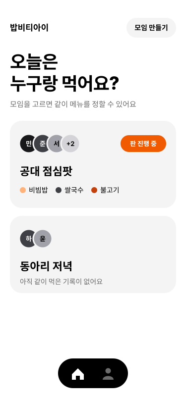
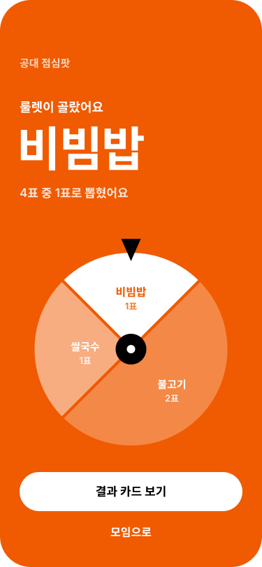
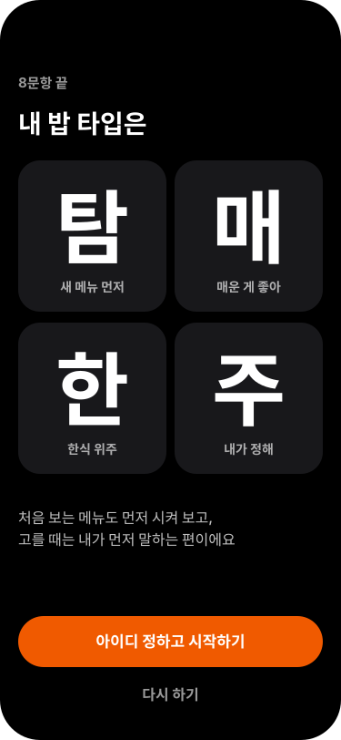
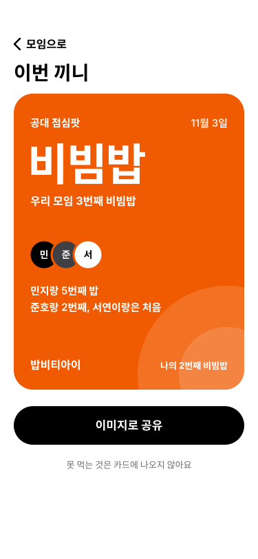

# 디자인 방향

2026-11-03 정함 (이슈 #45). 명세 7절의 디자인 규칙(주황 하나와 검정, 흰색, 회색, 공통 부품, 이모지 금지)은 그대로 두고, 그 위에 "어디를 얼마나 크게 보이게 하나"를 더한다. 1단계 화면 다듬기와 2단계 화면(I, J, K, L)은 이 파일을 따른다.

## 한 줄

평소 화면은 조용하게 두고, 결정이 나는 세 순간만 화면 전체를 쓴다.

중간 데모(11/11)와 데모데이(12/2)에서 다른 팀 학생들이 화면을 보고 평가한다. 화면 곳곳을 꾸미는 것보다 룰렛이 멈추는 순간, 내 네 글자가 나오는 순간, 공유할 카드가 크게 남는 쪽이 기억에 남는다. 색을 늘리지 않고 크기, 면, 움직임으로 화려하게 한다.

## 시안

<table>
<tr>
<td></td>
<td></td>
<td></td>
<td></td>
</tr>
<tr>
<td>평소 화면: 홈</td>
<td>순간 1: 룰렛이 멈출 때</td>
<td>순간 2: 네 글자가 나올 때</td>
<td>순간 3: 결과 카드</td>
</tr>
</table>

시안의 이름과 숫자는 가짜 데이터다. 실제 문구와 숫자는 명세 4절과 5절을 따른다.

## 1. 평소 화면

- 바탕 흰색(`bg-background`), 글자 검정(`text-text`), 카드 회색(`bg-surface`). 지금 홈 화면이 기준이다
- 글자 크기는 Tailwind 기본 단계만 쓴다

| 쓰는 곳 | 크기 | 굵기 |
|---|---|---|
| 화면 제목 ("오늘은 누구랑 먹어요?") | `text-4xl` | `font-extrabold tracking-tight` |
| 카드 제목 (모임 이름) | `text-2xl` | `font-extrabold` |
| 본문 | `text-base` | 기본 |
| 설명 | `text-sm` | 기본, `text-muted` |
| 세 순간의 큰 글자 | `text-6xl` ~ `text-8xl` | `font-extrabold` |

- 모서리: 카드는 `rounded-3xl`, 버튼과 알약은 `rounded-full`, 사람과 음식은 동그라미
- 사람은 이름 첫 글자를 넣은 회색 동그라미를 겹쳐 보인다. 색은 `food-8`, `food-2`, `food-4`, `food-6` 순서로 돌려 쓴다. 넷이 넘으면 네 번째 자리에 "+N"
- 주황은 카드마다 하나만 쓴다. 홈의 모임 카드라면 "판 진행 중" 알약이다. 사람 동그라미에는 쓰지 않는다
- 하단 탭(2단계)은 검정 알약에 흰 아이콘. 지금 화면의 아이콘만 흰색, 나머지는 `muted`
- 움직임은 누를 때 흐려지는 것(`active:opacity-80`, 지금 부품 그대로)뿐이다

## 2. 세 순간

### 순간 1. 룰렛이 멈출 때 (세션 결과, 4-12)

- 원판이 멈추면 바탕 전체가 주황(`bg-primary`)이 된다. 주황은 "고른 상태"라 명세 7절과 맞다
- 위에서부터 모임 이름(작게), "룰렛이 골랐어요", 음식 이름(`text-7xl`, 흰색), "N표 중 M표로 뽑혔어요"
- 원판은 그대로 남긴다. 뽑힌 조각만 흰색이고 나머지는 흰색을 옅게(조각마다 28%, 50%) 칠한다. 조각 안에 음식 이름과 표 수를 적는다. 표가 많을수록 조각이 커서, 표 수에 비례해 뽑는다는 동작 원리가 화면만 봐도 보인다
- 버튼: "결과 카드 보기"는 흰 바탕에 검정 글자(주황 바탕 위라서 주황 버튼을 쓰지 않는다), "모임으로"는 글자만
- 움직임: 원판이 멈추고 0.3초 뒤, 원판 가운데에서 바깥으로 0.45초 동안 주황이 번진다. 이어서 음식 이름이 0.9배에서 1배로 커지며 나타난다(0.2초). 진동은 지금처럼 멈출 때 한 번
- 담당: eoieiie (1단계 다듬기, 11/5)

### 순간 2. 네 글자가 나올 때 (온보딩 끝, 4-14)

- 바탕 전체가 검정이다. 2×2 칸에 네 글자를 하나씩 `text-8xl` 흰색으로 넣고, 칸 바탕은 `bg-food-8`이다. 글자 아래에 그 축의 뜻을 적는다 ("새 메뉴 먼저")
- 그 아래 두 줄 설명, 맨 아래 주황 버튼 "아이디 정하고 시작하기"와 글자 버튼 "다시 하기"
- 움직임: 칸이 0.12초 간격으로 하나씩, 아래에서 12만큼 올라오며 나타난다. 네 번째 칸이 나올 때 진동 한 번(`Haptics.notificationAsync(Success)`)
- 검정 바탕은 1단계 다듬기 PR에서 더하는 토큰 `ink`(#000000)와 그 위 글자 `on-ink`(#FFFFFF)로 쓴다
- 담당: Ruty041 (#40)

### 순간 3. 카드 (결과 카드 4-17, 내 프로필 4-15, 모임 카드 4-16)

- 공유되는 카드는 포스터처럼 만든다. 가로세로 4:5, `rounded-3xl`, 안쪽 여백 24
- 결과 카드: 주황 바탕. 위에 모임 이름과 날짜, 가운데 음식 이름(`text-6xl`)과 "우리 모임 N번째 OO", 같이 먹은 사람 동그라미와 "OO랑 N번째 밥", 아래에 "밥비티아이"와 "나의 N번째 OO". 오른쪽 아래에 옅은 흰 동그라미 두 개를 겹친다(음식 동그라미를 크게 키운 무늬)
- 내 프로필 카드: 검정 바탕에 순간 2의 네 글자 칸을 작게 넣는다. 아래에 아이디와 레벨
- 모임 카드(모임 화면 안에 있고 공유하지 않는다): 회색 카드. 태그별 인원은 검정 막대, 네 축은 가운데 0에서 양쪽으로 뻗는 막대. 3명 미만이면 명세 4-16의 문구
- 공유 버튼은 검정(`bg-ink`). 카드가 이미 주황이라 버튼까지 주황이면 강조가 둘이 된다
- 공유 카드 아래 한 줄: "못 먹는 것은 카드에 나오지 않아요" (명세 4-15)
- 움직임: 카드가 처음 보일 때만 0.96배에서 1배로 커진다(0.25초)
- 담당: eoieiie (#43 결과 카드), GONI1130 (#41 프로필 카드, #42 모임 카드)

## 3. 지키는 것

- 움직임은 이미 있는 `react-native-reanimated`로 만든다. 새 라이브러리를 넣지 않는다
- 기기에서 "동작 줄이기"를 켠 사람에게는 움직임 없이 마지막 모습만 보인다 (`useReducedMotion`)
- 움직임은 세 순간에만 넣고, 하나가 0.5초를 넘지 않는다. 시연 중에 기다리는 시간이 생기면 안 된다
- 진동은 `expo-haptics`로 순간마다 한 번
- 순간 화면도 색은 토큰 이름만 쓴다. 이모지와 테두리만 있는 박스는 여전히 쓰지 않는다 (`src/components/design-rules.test.js`)
- 시연은 웹(https://babti.expo.app)으로 한다. 폰 브라우저와 노트북 브라우저 둘 다에서 본다

## 4. 누가 언제

| 무엇 | 담당 | 언제 |
|---|---|---|
| 1단계 다듬기: `Card` 모서리, `ink`·`on-ink` 토큰, 홈 모임 카드(사람 동그라미, 최근 식사, 판 진행 중), 순간 1 | eoieiie | 11/5, 인터뷰 전 |
| 순간 2 | Ruty041 | #40 (11/18) |
| 하단 탭, 내 프로필 카드, 모임 카드 | GONI1130 | #41, #42 (11/18) |
| 결과 카드 | eoieiie | #43 (11/18) |
| 발표자료와 시연 영상도 같은 색과 글자를 쓴다 | 13주차에 정함 | 11/25 ~ 12/1 |
