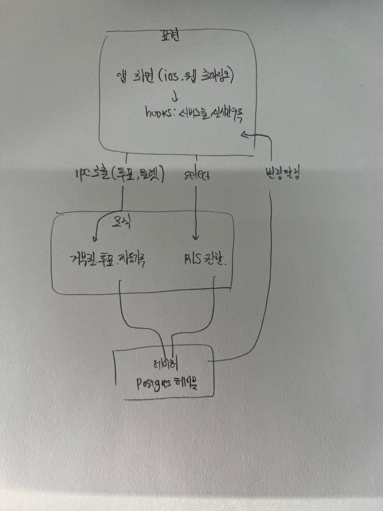
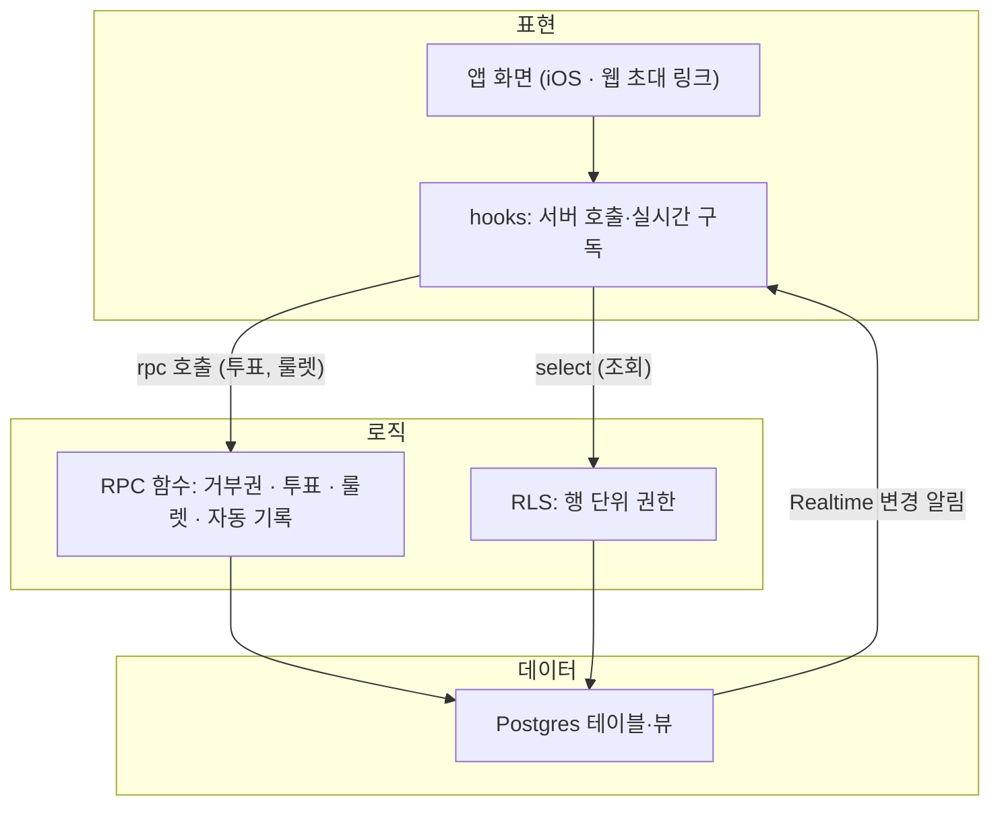

# Week 07 팀 활동지 / Team Activity

| 팀명 / Team | 작성일 / Date | 참여자 / Members |
|---|---|---|
| 세션 제한의 90%를 사용했습니다. | 2026-10-14 | 황병주 이혁준 이학준 이재곤 |

## 1. 아키텍처 다이어그램 / Architecture Diagram

손그림 사진을 올리고 링크하십시오 / Upload a photo and link it.

손그림은 아래 구조를 옮겨 그린다. 화살표는 데이터가 흐르는 방향이다.

| 계층 / Layer | 모듈·파일 / Modules | 의존하지 않는 것 / Does not depend on |
|---|---|---|
| 표현 / Presentation | 사용자가 보는 화면. `bapbti-app/src/app/`(홈·모임·세션·프로필·설정), `src/components/`(룰렛, 결과 카드), `src/hooks/`(서버에 요청하고 변경을 받아오는 코드) | 결과를 정하는 규칙. 화면은 "누가 빠졌는지, 무엇이 당첨됐는지"를 스스로 계산하지 않고 서버가 알려준 대로 그리기만 한다 |
| 로직 / Logic | 규칙을 실행하는 서버 함수. `supabase/migrations/0004_rpc.sql`의 거부권 판정(`compute_veto`), 투표(`cast_vote`), 룰렛 추첨(`spin_roulette`). 누가 어떤 데이터를 볼 수 있는지 정하는 권한 규칙(`0002_rls.sql`, `0010`) | 화면. 앱에서 부르든 웹에서 부르든 같은 규칙이 적용된다 |
| 데이터 / Data | 저장소. `0001_schema.sql`의 표(모임, 멤버, 투표, 식사 기록 등), `0003_views.sql`의 집계(누구와 몇 번 먹었는지 등), `supabase/seed/`의 음식 40개 | 로직과 화면. 데이터는 누가 꺼내 쓰는지 모른다 |

규칙을 화면이 아니라 서버에 둔 이유: 룰렛 결과를 휴대폰이 정하면 방장이 조작할 수 있다. "투표는 익명"이라는 약속도 화면에서 이름을 숨기는 것만으로는 부족하고, 서버가 아예 남의 표를 내주지 않아야 지켜진다.

### 기술 스택과 고른 이유 / Tech stack and rationale

| 무엇 | 쓰는 것 | 하는 일 | 고른 이유 |
|---|---|---|---|
| 앱 개발 도구 | Expo (React Native) | 코드 하나로 아이폰 앱과 웹페이지를 함께 만든다 | 앱을 설치하지 않은 친구도 초대 링크를 웹으로 열어 바로 참여해야 한다. 앱과 웹을 따로 만들 여유가 없다 |
| 언어 | TypeScript | 앱 코드를 쓰는 언어 | 오타나 잘못된 값을 실행 전에 잡아준다. 네 명이 같은 코드를 만지면 이런 실수가 늘어난다 |
| 화면 이동 | Expo Router | 화면 사이 이동, 초대 링크 주소(`/g/초대코드`) 처리 | 파일 이름이 곧 주소가 되어서, 링크를 눌렀을 때 어느 화면이 열리는지 폴더만 보고 알 수 있다 |
| 화면 꾸미기 | NativeWind (Tailwind) | 색, 간격, 글자 크기 지정 | 웹에서 많이 쓰는 방식이라 디자인 담당이 익히기 쉽다 |
| 서버·데이터베이스 | Supabase (PostgreSQL) | 데이터 저장, 서버 규칙 실행, 로그인 | 서버를 직접 띄우고 관리하지 않아도 된다. 무료 요금제로 학기 내내 운영할 수 있고, 팀장이 이전에 출시한 앱(브라키)에서 이미 써봤다 |
| 실시간 반영 | Supabase Realtime | 누가 투표하면 다른 사람 화면이 새로고침 없이 바뀐다 | 같은 자리에 모인 사람들이 동시에 쓰는 앱이라, 내 화면만 늦게 바뀌면 진행이 막힌다 |
| 로그인 | Supabase 익명 로그인 | 가입 없이 기기마다 사용자를 구분한다 | 초대 링크를 받은 사람이 회원가입부터 해야 하면 거기서 이탈한다. 이름만 적고 들어오게 했다 |
| 데이터 불러오기 | TanStack Query | 서버에서 받은 데이터를 잠시 저장해두고 필요할 때 다시 받는다 | 같은 데이터를 화면마다 따로 요청하지 않게 해준다 |
| 그림 | react-native-svg | 룰렛 원판 그리기 | 표 수에 따라 조각 크기가 바뀌는 원판을 직접 그려야 해서 |
| 결과 카드 공유 | react-native-view-shot, expo-sharing | 결과 화면을 이미지로 저장해 카톡·인스타로 공유 | 기록이 단톡방에 퍼지는 것이 다음 모임을 데려오는 통로다 |
| 다국어 | i18n-js, expo-localization | 한국어·영어 전환 | 교회 모임과 학교에 외국인 학생이 많다 |
| 배포 | EAS Build·Submit·Update, EAS Hosting | 아이폰 앱 빌드와 TestFlight 업로드, 웹 배포, 앱스토어 심사 없이 수정본 반영 | 팀장의 Apple 개발자 계정과 기존 배포 과정을 그대로 재사용한다 |
| 테스트·검사 | Jest, ESLint | 규칙 함수 자동 테스트, 코드 규칙 검사 | 룰렛 후보 고르기처럼 틀리면 안 되는 규칙을 테스트로 고정한다 |
| 자동화 | GitHub Actions | 올릴 때마다 검사 자동 실행, 무료 서버가 잠들지 않게 주기적으로 깨우기 | Supabase 무료 요금제는 1주일 동안 안 쓰면 멈춘다 |

검토했다가 고르지 않은 것:

- Next.js 웹앱만 만들기: 처음에 AI가 추천했다. "애플 개발자 계정이 없다"는 잘못된 전제에서 나온 추천이었다. 계정이 이미 있었고, 웹만으로는 진동(햅틱)과 앱 아이콘으로 다시 찾아오게 하는 경험을 줄 수 없어서 버렸다.
- Flutter + Firebase: 앱과 웹을 함께 만들 수는 있지만, 기능이 아쉽다. Firebase는 데이터 구조가 표가 아니라서 "누구와 몇 번 먹었는지" 같은 집계를 하기 어렵다.

## 2. 이슈 / Issues

> 이슈 = **앞으로 할 일** / An issue is work to be done.
> 개발할 때 커밋에 이슈 번호를 붙이고(`#3 알레르기 필터 추가`), 완료 조건을 만족하면 이슈를 닫습니다.
> Add the issue number to commits, and close the issue when its criteria are met.

이슈는 코드가 있는 저장소 `eoieiie/BapBTI`에 각자 하나씩 직접 올린다. 번호는 올린 뒤 이 표에 고쳐 적는다.

| #     | 제목 / Title        | 라벨 / Label | 담당 / Assignee | 완료 조건 / Acceptance Criteria                                                           |
| ----- | ----------------- | ---------- | ------------- | ------------------------------------------------------------------------------------- |
| 예시 #3 | 알레르기 필터           | backend    | 홍길동           | '땅콩'을 선택하면 땅콩이 들어간 메뉴가 추천 결과에서 빠진다                                                    |
| #1    | 투표 익명을 서버 권한으로 보장 | backend    | 황병주           | 다른 멤버의 표를 API로 조회하면 0행이 나온다. 초대 링크로 들어온 사람이 온보딩 없이 투표까지 간다                            |
| #2    | 사전 수요 조사 설문 배포    | research   | 이재곤           | 응답 30개 이상. 주관식 답변 5개를 `docs/survey-result.md`에 원문 그대로 옮긴다                             |
| #3    | 기존 서비스 비교         | research   | 이학준           | 메뉴 룰렛 앱 2개와 단톡방 투표를 같은 기준(결정 시간, 못 먹는 것 처리, 기록 여부)으로 비교한 표가 `docs/competitors.md`에 있다 |
| #4    | 사용자 테스트 1회        | test       | 이혁준           | 팀 밖 4명 이상이 한 세션을 결과까지 끝낸다. 막힌 지점을 각각 이슈로 등록한다                                         |

## 3. 마일스톤 / Milestones

| 마일스톤 / Milestone | 마감 / Due | 포함 이슈 / Issues |
|---|---|---|
| MVP 완료 | 11주차 | #1 #2 #3 #4. 완료 기준: 실제 모임에서 세션 1회를 결과까지 끝낸다 |
| 실행 패키지 | 13주차 | 웹 배포, TestFlight 빌드, App Store 제출 준비 (MVP 뒤에 등록). 완료 기준: App Store 심사 제출 |

> AI를 사용했다면 `PROMPTS.md`에 기록 / Log any AI use in `PROMPTS.md`
